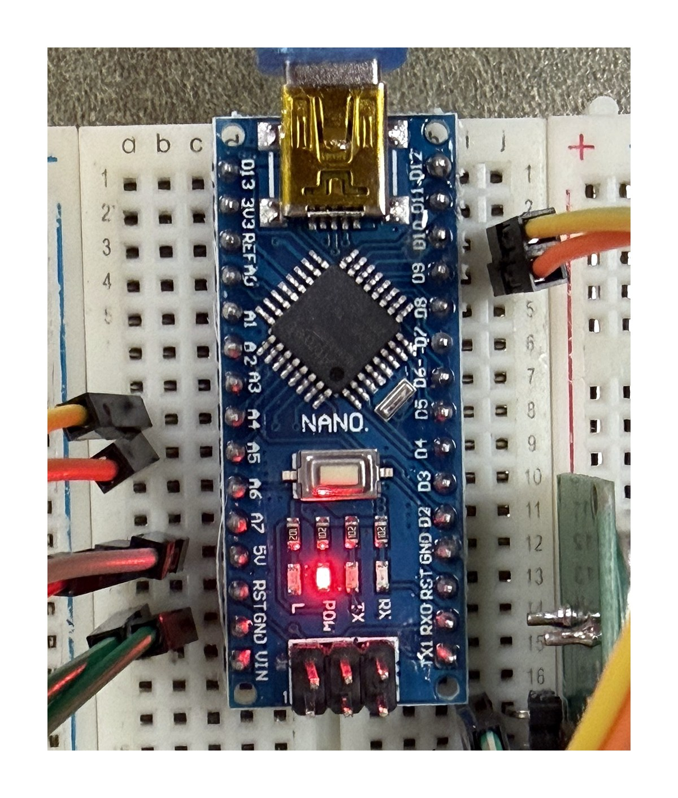
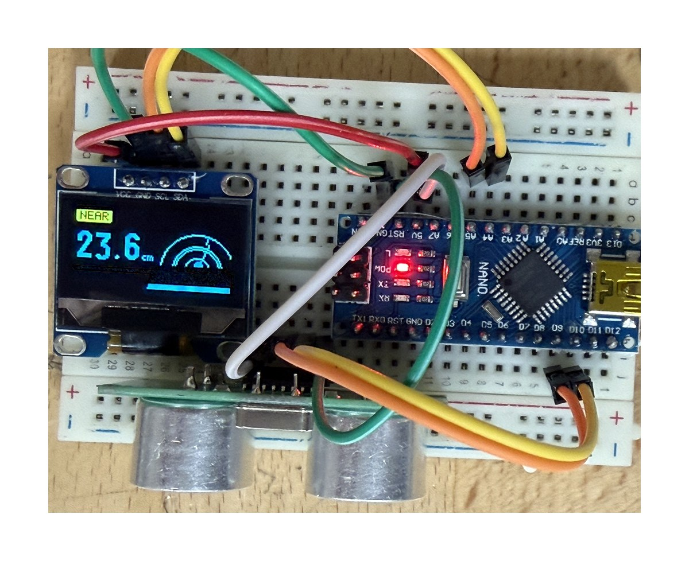

# Distance Names

## Charter

The Sensor Piece sees distance, names the visitor one of three group names or `nobody`, and answers with a distinct OLED word, light, and tone. The Nano is the whole instrument: it does not depend on a laptop, Serial Monitor, or browser. This is not identity recognition. An ultrasonic reading names a distance zone, not a person.

## State Table

| Owner | Name | Rule | Final numbers | Hold | Response |
|---|---|---|---|---|---|
| Jaxson William Character | Jaxson | cm <= 30 | 0-30 cm | 1.0 s | Red LED, 660 Hz tone, JAXSON |
| Diego Ortega | Diego | 30 < cm <= 120 | 31-120 cm | 2.0 s | Green LED, 440 Hz tone, DIEGO |
| Brennan Soloman Howard-Ruelas | Brennan | 120 < cm <= 200 | 121-200 cm | 2.0 s | Blue LED, 330 Hz tone, BRENNAN |
| Group | nobody | cm > 200 or no echo | 201-400 cm | 3.0 s | LEDs off, no tone, NOBODY |

The browser and Nano use the same boundaries and holds. `GAP_CM` is 10 cm in `bench/bench.ino`; readings stay at the last quiet value instead of jumping at each line. The hold begins only when a candidate rule remains true.

## Wiring

- HC-SR04/US-025A VCC -> Nano 5V
- Sensor GND -> Nano GND
- Sensor TRIG -> D9
- Sensor ECHO -> D10
- OLED VCC -> 5V, GND -> GND, SDA -> A4, SCL -> A5
- Jaxson red LED -> D3 through a 220 ohm resistor
- Diego green LED -> D4 through a 220 ohm resistor
- Brennan blue LED -> D5 through a 220 ohm resistor
- Buzzer positive -> D6, buzzer negative -> GND

Every LED and the buzzer share Nano GND. Push wires fully into the breadboard and tape the Nano and sensor leads after testing. Power can be a 5V USB wall charger or power bank.

## How to run it

1. Open `bench/bench.ino` in the Arduino IDE, select Arduino Nano / ATmega328P and upload. If an old-clone Nano fails, select Tools -> Processor -> ATmega328P (Old Bootloader).
2. Disconnect USB and connect a USB wall charger or power bank. The sketch starts immediately; no Serial Monitor is required.
3. Hold a hand at each boundary for longer than the row's hold. The OLED prints `JAXSON cm 23.6`, `DIEGO cm 80.0`, `BRENNAN cm 160.0`, or `NOBODY cm 400.0`.

For the browser bench: open `bench.html` on localhost in Chrome or Edge, close the Arduino IDE Serial Monitor, click **Connect the Arduino**, and press D. Open `bench.html` in the December viewer context.

## Break log

| Reading or test | Failure | Adjustment |
|---|---|---|
| 29.5 cm / 30 cm edge | 0.5 cm echo noise could cross the line | 10 cm `GAP_CM`; Jaxson hold 1.0 s |
| 119.5 cm / 120 cm edge | Rapid alternating readings between Diego and Brennan | 2.0 s candidate hold for both rows |
| 199.5 cm / 200 cm edge | Brennan response could flicker into nobody | 2.0 s Brennan hold and 3.0 s nobody hold |
| No echo / empty room | Timeout could read a short random gap | 400 cm fallback and 3.0 s nobody hold |
| Sensor facing clothing or ceiling | Soft surfaces absorb sound and return no echo | nobody fallback is conservative; aim sensor at visitors |

## Fairness and legibility

**For them:** a stranger can look at the OLED or LED and tell the state called it; the browser canvas prints the word and centimetre reading. **To them:** the piece does not infer identity. A visitor may be called Jaxson, Diego, or Brennan because they occupy that distance, and the name is not a claim about who they are.

## Credits

- Jaxson William Character: Jaxson row, 0-30 cm, 1.0 s hold, red LED/660 Hz response.
- Diego Ortega: Diego row, 31-120 cm, 2.0 s hold, green LED/440 Hz response.
- Brennan Soloman Howard-Ruelas: Brennan row, 121-200 cm, 2.0 s hold, blue LED/330 Hz response.
- The nobody row and shared wiring are owned by the group.
- Sensor: HC-SR04/US-025A ultrasonic distance sensor.
- Live page: https://glassc0ffin.github.io/ZZZ/
