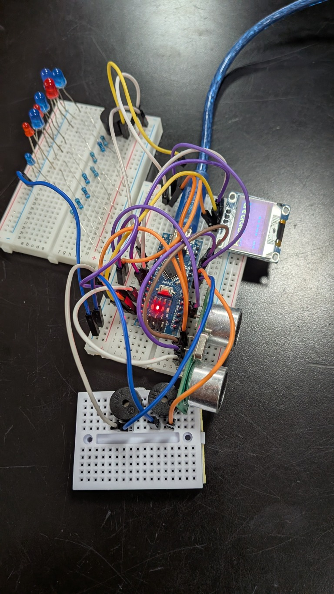

# Distance Names

## Charter

Distance Names uses ultrasonic distance to choose a group name, then responds with that name on an OLED, a matching LED, and a distinct buzzer tone. It does not recognize people: it names a distance zone, not anyone's identity.

## Our Sensor

The finished prototype has two ultrasonic modules, an Arduino Nano, an OLED, LEDs, and a buzzer. The current sketch reads the primary module on D9/D10; the second module is physically present but is not used by this version of the code. Each state already works from the first sensor alone.

## State Table

| Owner | State | Distance rule | Hold | Response |
|---|---|---:|---:|---|
| Jaxson William Character | Jaxson | `cm <= 30` | 0 s | Red LED, 880 Hz tone |
| Diego Ortega | Diego | `30 < cm <= 120` | 0 s | Green LED, 660 Hz tone |
| Brennan Soloman Howard-Ruelas (Bremer) | Bremer | `120 < cm <= 200` | 0 s | Blue LED, 440 Hz tone |
| Group | nobody | `cm > 200` or no echo | 0 s | LEDs off, 220 Hz tone |

The state changes on the first filtered reading in a new range. The sensor takes the median of three quick measurements to reject a single bad echo; there is no timed hold or artificial pause. Each state plays its own short tone when entered.

## Wiring

The code's primary ultrasonic module is wired `TRIG -> D9`, `ECHO -> D10`, `VCC -> 5V`, and `GND -> GND`. The OLED uses I2C (`SDA -> A4`, `SCL -> A5`). The name LEDs use D3, D4, and D5, each with a current-limiting resistor; the buzzer uses D6. Connect all grounds together. Confirm the second module's pin connections against the physical build before enabling it in code.

## Run It

1. Open `bench/bench.ino` in Arduino IDE, choose Arduino Nano and **ATmega328P (Old Bootloader)** if your clone needs it, then upload.
2. Power the Nano with a USB wall charger or power bank; the sketch starts automatically and does not need a laptop or Serial Monitor.
3. Move a hand through each distance range. The OLED shows the name and centimetres, and each name has its own LED and tone.

Serial output is available for testing at 115200 baud as `cm 23.6`. Close the Serial Monitor before connecting `bench.html`.

## Break Log

| Issue | Change |
|---|---|
| Ultrasonic echo occasionally jumps | Use the median of three readings; no extra timed hold |
| Slow response at state boundaries | Removed per-state delays and the loop's 50 ms delay |
| Names sounded alike | Use 880, 660, 440, and 220 Hz tones for Jaxson, Diego, Bremer, and nobody |
| No echo | Treat timeout or readings under 2 cm as 400 cm, which selects nobody |

## Legibility and Fairness

**For them:** the OLED says the state name and distance, and a matching LED and tone make the response visible and audible. **To them:** someone can receive a name because of where they stand, not who they are. The piece may misname a visitor at a range boundary and makes no claim to identify them.

## Credits

- Jaxson William Character owns Jaxson.
- Diego Ortega owns Diego.
- Brennan Soloman Howard-Ruelas (Bremer) owns Bremer.
- The group owns the nobody state and shared build.
- Sensor: two ultrasonic modules are mounted; current code uses one.
- Repository: https://github.com/GlassC0ffin/ZZZ
- Live page: https://glassc0ffin.github.io/ZZZ/
